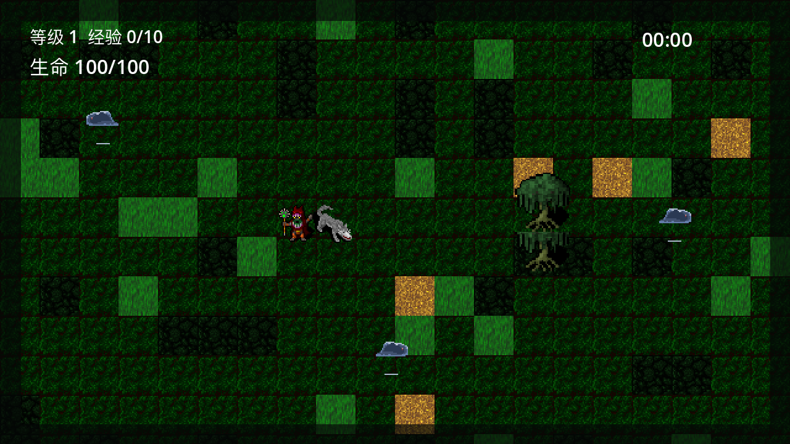
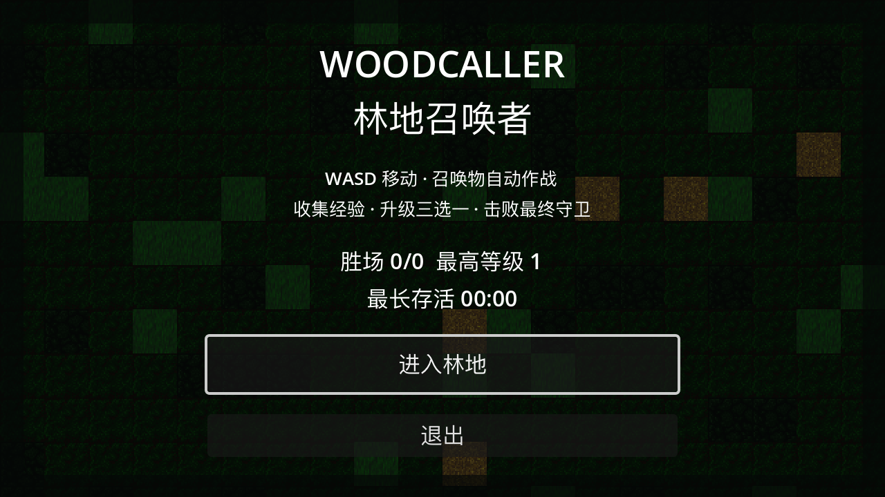
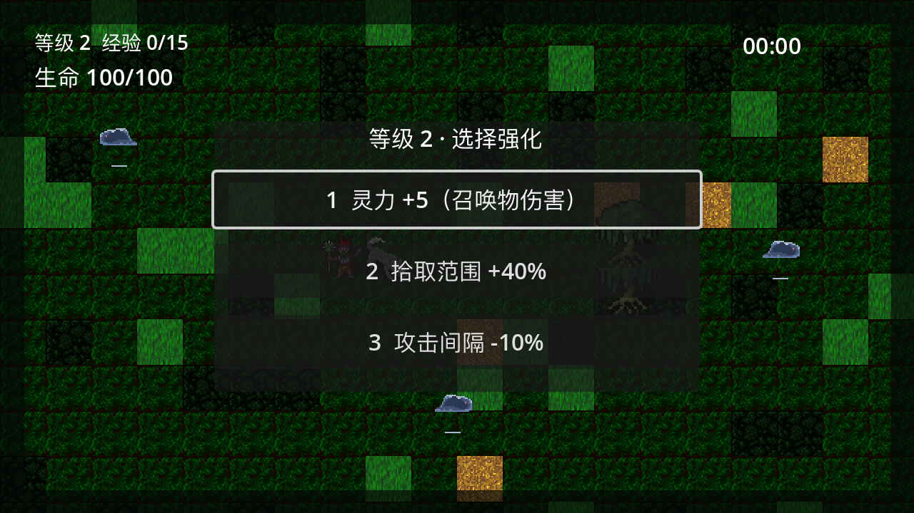
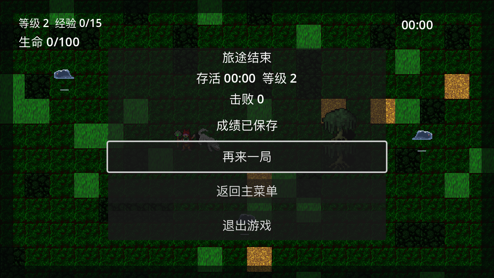

# Woodcaller（林地召唤者）

Godot 4.7.2 开发的 2D 俯视角召唤师幸存者 roguelike：你不直接攻击，靠召唤狼群在黑暗森林中抵御史莱姆潮，存活 30 分钟并击败最终守卫「林地守卫」即获胜。



## 玩法

- **WASD** 移动（玩家无普攻）
- 召唤物自动索敌攻击；敌人死亡掉落经验球，靠近拾取
- 升级时世界暂停，从 **7 种词条中随机三选一**（点击或按 1/2/3）：灵力、移速、召唤数量、攻击间隔、生命上限、攻击范围、拾取范围，各词条有叠加上限
- 波次难度随时间递增；30 分钟 Boss 登场，击败获胜，生命归零失败
- 结算支持再来一局/返回主菜单，跨局成绩自动存档

| 主菜单 | 升级三选一 | 结算 |
| --- | --- | --- |
|  |  |  |

## 运行

1. 安装 Godot 4.7.2 标准版，双击 `Open_Woodcaller.command`（或直接用 Godot 打开本目录）
2. F5 运行，主菜单点击「进入林地」

macOS 用户也可使用预构建的本地测试包（Intel + Apple Silicon 双架构，ad-hoc 签名）：

```sh
./tools/build_macos.command   # 产出 builds/Woodcaller.app 与 zip
```

构建、签名边界与手动验收清单见 [EXPORT_MACOS.md](EXPORT_MACOS.md)。

## 测试

```sh
python3 tests/run_tests.py
```

13 组 headless 集成回归（移动、追击、召唤、经验词条、波次、存档、Boss、结算、主菜单、美术、音频、压力/长局），全部通过且无引擎 ERROR 为合格；输出在 `tests/results/current-*.log`。

## 目录结构

- `scenes/` 游戏场景（主菜单、竞技场、玩家/敌人/召唤物/Boss/经验球）
- `scripts/` GDScript 模块（含 SaveStore/WaveDirector/Sfx/Music 四个 Autoload）
- `assets/art|audio/` CC0 像素素材与音频，授权登记见 [ART_CREDITS.md](assets/ART_CREDITS.md)
- `tests/` 集成测试与结果快照；`tools/` 素材管线与打包脚本
- [START_HERE.md](START_HERE.md) 新手入口；[Woodcaller_Project_Log.md](Woodcaller_Project_Log.md) 完整开发日志

## 素材与授权

- Dungeon Crawl 32×32 tiles（CC0）、rvros Animated Slime（CC0）
- Juhani Junkala 512 SFX（CC0）、beardalea《Dark Woods Loop》BGM（CC0）
- 完整来源与用途映射：[assets/ART_CREDITS.md](assets/ART_CREDITS.md)；引擎与第三方声明：[THIRD_PARTY_NOTICES.txt](THIRD_PARTY_NOTICES.txt)

## 当前状态与限制

- 阶段 1～14 完成：核心循环、美术/音频接入、词条扩展、压力测试、macOS Universal 测试包重建，13 组回归全绿
- 已知限制：敌人正面遇墙不绕路；不支持中途续局；BGM 为约 36 秒短循环；测试包未公证未沙盒
- 待人工验收：真实键盘/切窗、30 分钟完整游玩与数值平衡、Apple Silicon 实机
